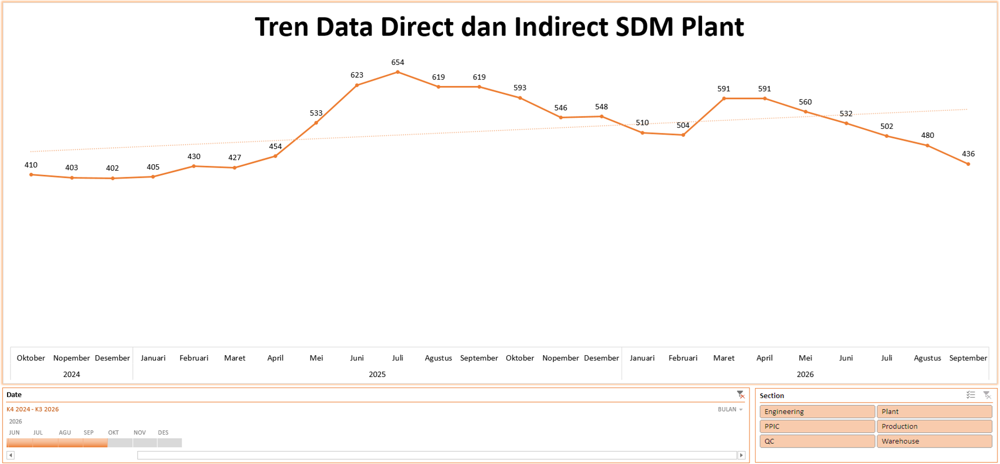
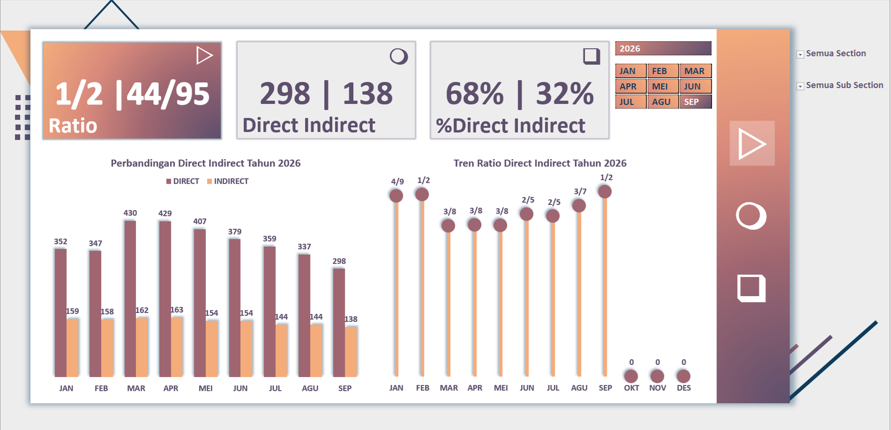
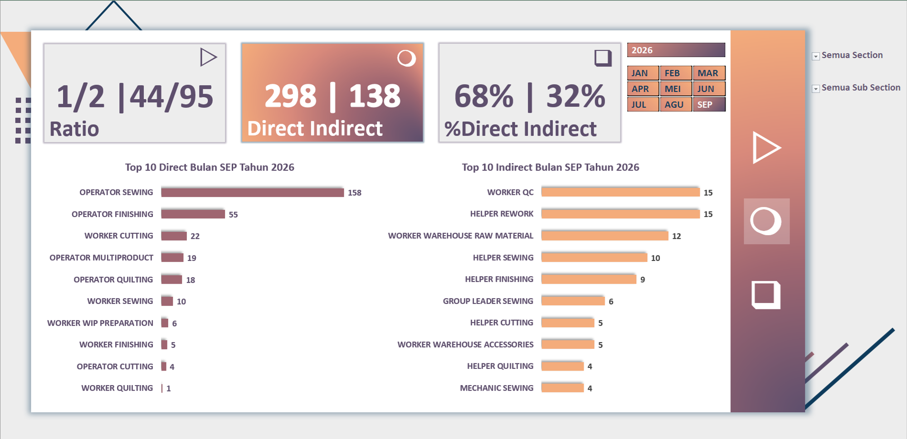
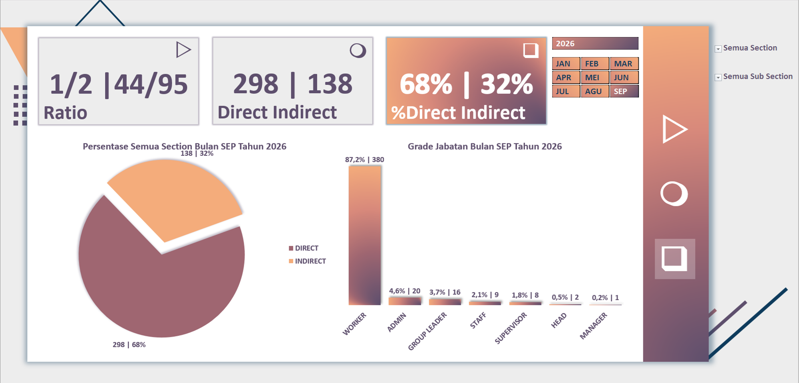

# Project 1: Dashboard Direct dan Indirect Plant

Dalam proyek ini, saya menganalisis fluktuasi demografi tenaga kerja harian di pabrik serta rasio penempatannya (*Direct* vs *Indirect Labor*). Fokus utama proyek ini adalah mengidentifikasi efisiensi pengeluaran *overhead* tenaga kerja di tengah tren pergerakan jumlah karyawan.

## Overview Masalah
Pabrik mengalami penyusutan drastis pada jumlah tenaga kerja operasional. Tercatat penurunan grafik dari titik puncak 654 orang pada bulan Juli 2025 menjadi hanya 436 orang pada bulan September 2026. Penurunan jumlah staf operasional ini membawa risiko terhentinya target produksi jika komposisi yang tersisa tidak dialokasikan dengan tepat.

## Analisis Mendalam
Berdasarkan data terkini, rasio tenaga kerja masih dapat dipertahankan di angka 68% *Direct Labor* (298 orang) dan 32% *Indirect Labor* (138 orang). Jabatan *Worker* mendominasi hierarki dengan porsi 87,2% (380 orang). 
Secara spesifik, tulang punggung operasional dipegang oleh Operator Sewing (158 orang) dan Finishing (55 orang). Namun, proporsi pekerja pendukung (*Indirect*) seperti Worker QC (15) dan Helper Rework (15) mengambil porsi yang cukup besar (32%). Jika volume pesanan turun, rasio 32% *indirect labor* ini akan membebani *fixed cost* perusahaan secara tidak proporsional.

## Rekomendasi Bisnis
1. **Hiring Freeze:** Terapkan pembekuan rekrutmen (*hiring freeze*) sementara khusus untuk posisi *Indirect* (Helper, Staff pendukung) untuk mencegah pembengkakan biaya gaji.
2. **Retensi Pekerja Utama:** Fokuskan anggaran insentif untuk mempertahankan Operator berbasis *output* (*Direct*) yang merupakan pusat penciptaan nilai (*value generator*). Targetkan rasio *Direct Labor* berada di atas 75%.

## Catatan Penting
Hasil pengolahan data ini memberikan perubahan kebijakan di tahun 2026 terkait *labelling* antara departemen HR&GA dan Plant khususnya terkait status yang jelas pada jabatan yang dianggap berbasis *output* (*Direct*) dan tidak berbasis *output*(*Indirect*) yang pada tahun sebelumnya tidak terdapat kejelasan status.
