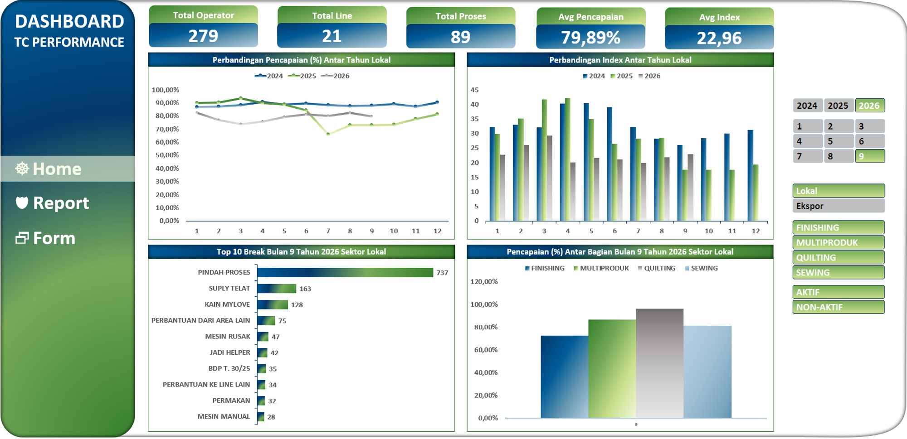

# Project 2: Dashboard Performa Operator

Proyek ini melacak efisiensi waktu kerja dan capaian target (*Target/Capacity Performance*) harian para operator. Analisis ini sangat penting untuk menemukan kebocoran produktivitas dari aspek gerakan dan alur kerja.

## Overview Masalah
Dari pantauan 279 total operator di 21 lini produksi, tingkat rata-rata pencapaian (*Avg Pencapaian*) tidak maksimal, hanya berada di angka 79,89% dengan rata-rata indeks capaian di 22,96.

## Analisis Mendalam
Kesenjangan efisiensi sebesar 20% ternyata tidak disebabkan oleh mesin rusak, melainkan inefisiensi pergerakan dan logistik. Dari analisis grafik *Top 10 Break* (faktor waktu terbuang), hambatan tertinggi dipegang oleh "Pindah Proses" yang mencatat 737 insiden, disusul oleh "Supply Telat" sebanyak 163 insiden. Tingginya angka pindah proses menandakan tata letak mesin yang berjauhan untuk satu alur produk.

## Rekomendasi Bisnis
1. **Rombak Layout Jahit:** *Sub Section* *Industrial Engineering* harus melakukan penataan ulang tata letak (*line balancing*) mesin jahit agar proses yang berkesinambungan posisinya berdekatan, menghapus jarak tempuh "Pindah Proses".
2. **Implementasi Sistem Tarik (Kanban):** Terapkan sistem penyediaan material secara *Just-in-Time* agar gudang menyuplai kain tepat sebelum habis, memutus rantai masalah "Supply Telat".

## Catatan Penting
Untuk pencatatan di produksi dengan model kanban sudah diterima oleh manajemen dengan saran untuk peralihan ke digitalisasi input yang sebelumnya berbasis manual dan tidak tercatat secara dokumen di komputer. Karena ini penting untuk keperluan (*line balancing*) yang terkontrol oleh tim *Industrial Engineering* (IE).
