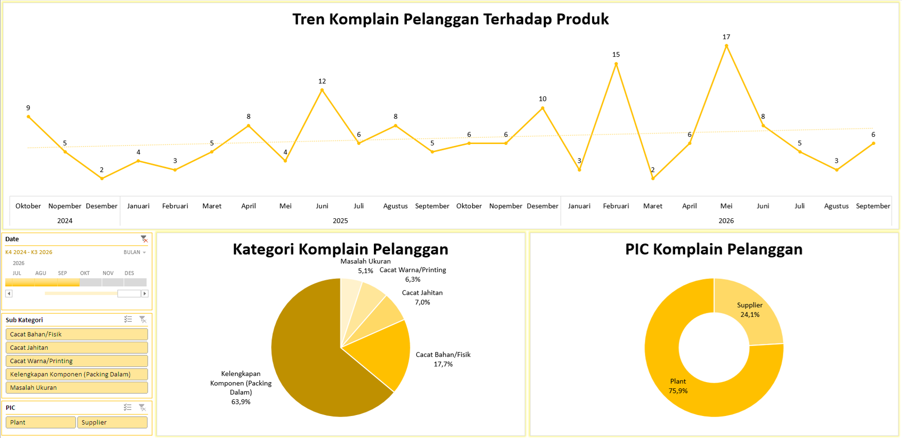

# Project 3: Dashboard Customer Complaint

Proyek ini membedah tren keluhan pelanggan terkait produk. Dengan memisahkan akar penyebab masalah, pabrik dapat menentukan apakah kesalahan berada di internal atau pada pihak ketiga (*supplier*).

## Overview Masalah
Manajemen menerima lonjakan komplain dari konsumen yang merusak reputasi kualitas produk perusahaan. Data menunjukkan bahwa 75,9% dari total keluhan bersumber dari kesalahan *Plant* (pabrik internal), sementara hanya 24,1% yang murni karena kesalahan *Supplier*.

## Analisis Mendalam
Dua masalah terbesar mendominasi grafik kategori komplain: "Kelengkapan Komponen (Packing Dalam)" dengan kontribusi 63,9%, dan "Cacat Bahan/Fisik" di angka 17,7%. Kesalahan kelengkapan (*missing items*) di dalam kemasan adalah indikasi kuat adanya kelalaian parah di *Sub Section Finishing* (pengemasan akhir), di mana operator melewatkan prosedur pengecekan.

## Rekomendasi Bisnis
1. **Otomatisasi Inspeksi Berat:** Pasang timbangan sensor otomatis (*weight checker*). Jika berat paket tidak sesuai dengan master data (kurang komponen), alarm akan berbunyi dan paket ditolak.
2. **Quality Check Berlapis:** Terapkan sistem *2-step verification* di mana *Packer* dan *QC Final* harus menandatangani label bersama sebelum dus ditutup rapat.

## Catatan Penting
Untuk penyediaan timbangan berbasis sensor otomatis sudah dilakukan namun di sektor ekspor saja. Dengan munculnya data ini diharapkan pada periode depan menjadi pertimbangan untuk juga dilakukan pada produk reguler.
