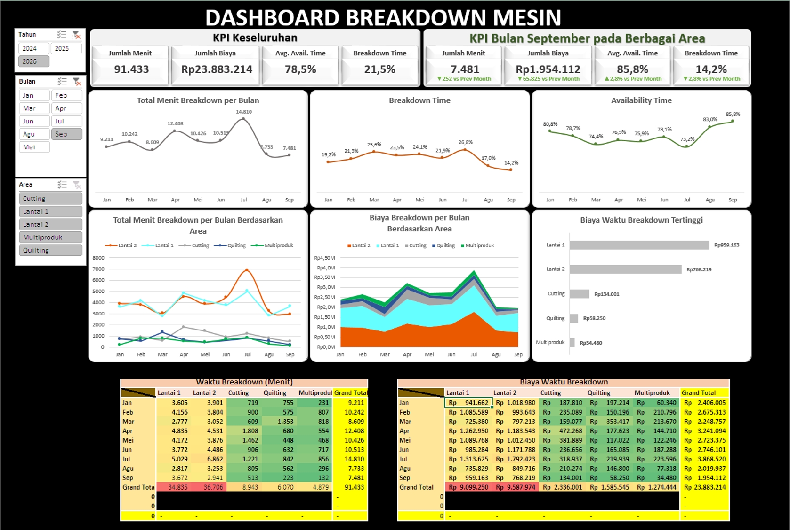

# Project 4: Dashboard *Breakdown* Mesin

Proyek ini berfokus pada keandalan aset mesin pabrik. Saya menganalisis akumulasi waktu henti (*downtime*) dan memetakan zona mana di lantai produksi yang paling membocorkan anggaran perbaikan akibat kerusakan mendadak.

## Isu
Tingginya gangguan produksi tercermin dari hilangnya waktu operasional sebesar 91.433 menit akibat mesin rusak, yang menyumbang tingkat *Breakdown Time* sebesar 21,5%. Hal ini disertai dengan pengeluaran *Maintenance Cost* sebesar Rp23.883.214 pada periode tersebut.

## Analisis Data
Kebocoran anggaran perbaikan terpusat pada dua zona kritis: Lantai 1 (Rp9.587.974) dan Lantai 2 (Rp9.099.250). Area lainnya seperti *Cutting* memakan biaya yang jauh lebih rendah. Waktu kerusakan terbanyak disebabkan oleh "Kondisi Abnormal" dan disusul oleh masalah jarum mesin (contoh: Benang putus). Meski sering terganggu, *Available Time* mesin (saat tidak rusak) masih kuat di angka 85,8%.

## Saran
1. **Audit Instalasi Lokal:** Terjunkan tim teknisi (*Engineering*) untuk melakukan audit kelistrikan dan suku cadang secara spesifik pada mesin-mesin di Lantai 1 dan Lantai 2. 
2. **Perubahan Strategi Perawatan:** Hentikan pemeliharaan reaktif (*run-to-failure*). Implementasikan *Preventive Maintenance* berjadwal ketat di dua lantai tersebut untuk menekan angka *Breakdown Time* ke bawah 10%.

## Catatan
Pada beberapa mesin produksi yang menggunakan teknologi *inverted* sudah dilakukan pengecekan oleh tim teknisi dari *GA* bersama pihak teknisi eksternal dan ditemukan bahwa kondisi listrik di pabrik tidak stabil dan *grounding* bermasalah.
