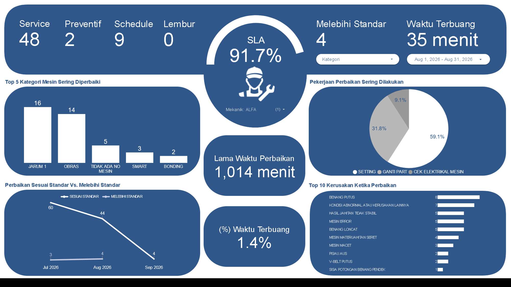

# Project 5: Dashboard Performa Mekanik

Proyek ini mengukur produktivitas dan kecepatan respon individu tim *Maintenance* (Mekanik). Tujuannya adalah mengidentifikasi *Service Level Agreement* (SLA) perbaikan dan standarisasi keahlian teknis.

## Isu
Terdapat kesenjangan (variansi) performa yang tajam di dalam tim mekanik, yang menyebabkan waktu tunggu perbaikan mesin di lantai produksi menjadi sulit diprediksi secara konsisten.

## Analisis Data
Mekanik Ariyanto berhasil mencetak SLA luar biasa (94,7%) dengan meminimalkan waktu terbuang hanya menjadi 43 menit. Mekanik Chrisnanto juga berkinerja baik di SLA 93,4% (45 menit). Sebaliknya, Mekanik Weldy berada di posisi terbawah dengan SLA hanya 85,7% dan akumulasi waktu terbuang mencapai 145 menit. Sebagian besar kendala yang ditangani mereka adalah masalah seragam, yakni "Benang Putus" dan "Kondisi Abnormal" mesin.

## Saran
1. ***Shadowing Program* (Pendampingan):** Wajibkan Mekanik Weldy untuk melakukan *shadowing* (bekerja berdampingan) dengan Ariyanto atau Chrisnanto selama 1 bulan penuh guna menyelaraskan metodologi diagnosis kerusakan dan percepatan perbaikan.
2. ***Knowledge Base* Mekanik:** Buat SOP tertulis berbentuk *troubleshooting flowchart* untuk masalah "Benang Putus" agar mekanik *junior* dapat menyelesaikannya dalam waktu kurang dari 10 menit.
