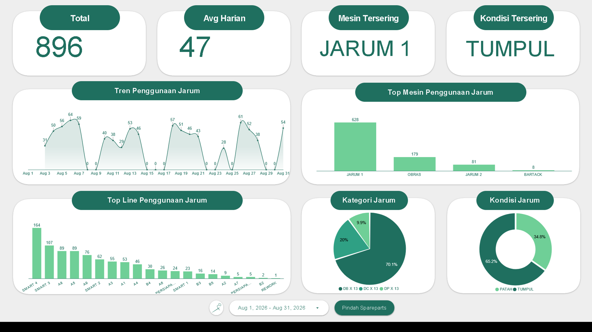

# Project 6: Dashboard Penggunaan Jarum

Proyek analisis logistik spesifik ini memantau tren pergantian jarum mesin jahit untuk mencegah kerusakan bahan (kain) akibat alat yang tidak layak pakai.

## Isu
Pabrik menghabiskan total 896 unit jarum dengan rata-rata konsumsi mencapai 47 unit jarum per harinya. Pergantian yang reaktif berisiko membuat jahitan pada kain cacat sebelum operator menyadari masalahnya.

## Analisis Data
Data menunjukkan kondisi yang menyebabkan pergantian jarum didominasi oleh jarum yang sudah "Tumpul" (65,2% kasus). Pengguna jarum terbanyak secara mutlak adalah mesin "Jarum 1" yang mencatat 628 kejadian pergantian (jauh melampaui mesin Obras yang hanya 179 kejadian). Penggunaan jarum sampai tumpul ini menjadi penyebab tingginya kasus "Benang Putus" pada dasbor performa mekanik sebelumnya.

## Saran
1. ***Preventive Replacement*:** Ubah regulasi pemeliharaan khusus untuk "Jarum 1". Jangan tunggu sampai tumpul. Lakukan penggantian jarum secara terjadwal (misal: setiap 2 hari atau x-jam pemakaian) untuk mencegah cacat *stitching* pada bahan.
2. **Edukasi Operator:** Latih operator jahit untuk mengenali tanda awal ketajaman jarum menurun tanpa harus menunggu instruksi mekanik.
