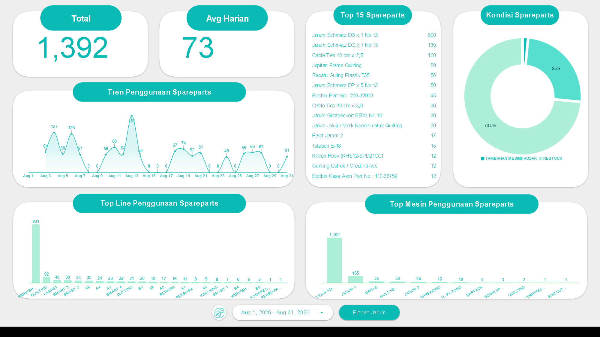

# Project 7: Dashboard Penggunaan *Spareparts*

Proyek ini melacak pemakaian keseluruhan suku cadang pabrik untuk optimalisasi pengadaan (*procurement*) dan menekan pengeluaran perbaikan fasilitas.

## Isu
Pabrik harus menyediakan anggaran harian yang cukup besar untuk memfasilitasi penggantian 1.392 suku cadang dengan rata-rata arus pengeluaran gudang sebanyak 73 *spareparts* per hari.

## Analisis Data
Alokasi *budget* terbesar terserap oleh satu item spesifik: "Jarum Schmetz DB x 1 No 13" yang pengeluarannya mencapai 600 unit, disusul tipe DC x 1 sebanyak 130 unit. Alasan mayoritas suku cadang ini diganti adalah karena "Rusak" dengan porsi 73,5% dari total kasus penggantian.

## Saran
1. **Optimasi Kontrak Pengadaan:** Mengingat konsumsi harian Jarum *Schmetz DBx1* yang ekstrem, tim *Procurement* harus segera menegosiasikan kontrak tarif volume besar (*bulk/wholesale pricing*) atau meningkatkan *Minimum Order Quantity* (MOQ) dengan *supplier* untuk mendapat diskon persentase besar.
2. **Review Kualitas Sparepart:** Jika rasio kerusakan sebesar 73,5% dianggap terlalu tinggi untuk usia pakai wajar, segera uji coba merek jarum alternatif untuk perbandingan daya tahan.
