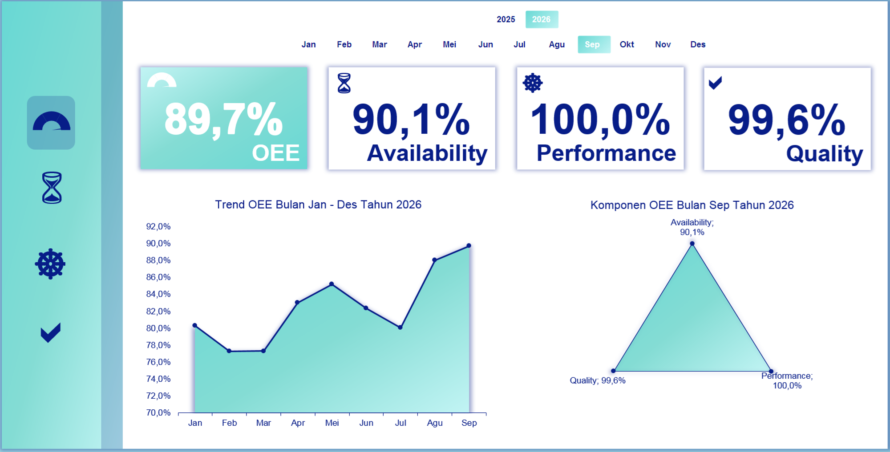
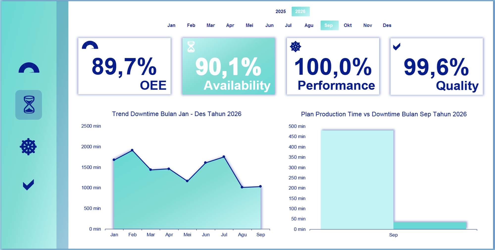
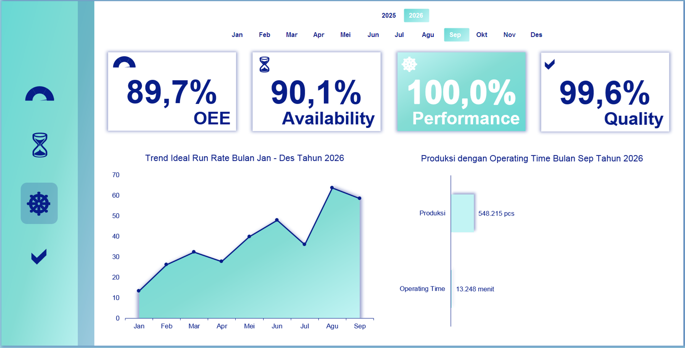
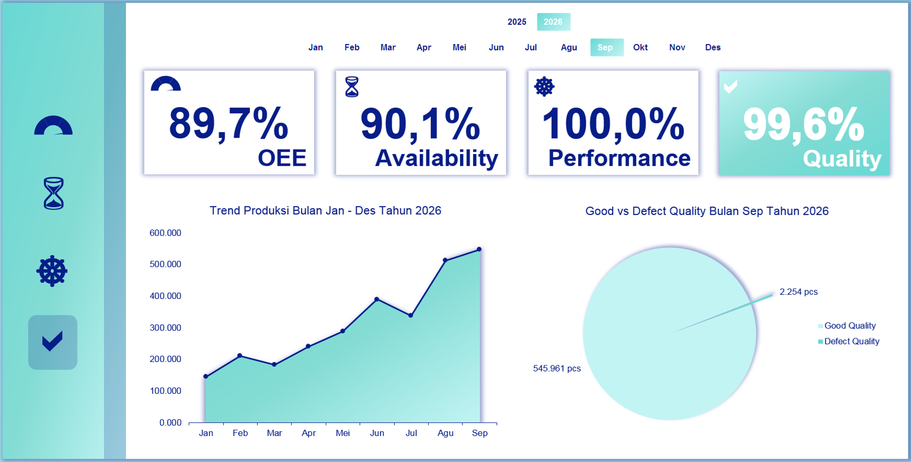

# Project 8: Dashboard *OEE (Overall Equipment Effectiveness)*

Proyek ini mengukur performa fasilitas manufaktur secara keseluruhan menggunakan metrik standar industri global (*OEE*) guna membedah ketersediaan, performa, dan mutu operasional mesin.

## Isu
Manajemen perlu mengetahui apakah nilai aset permesinan di lantai pabrik telah dieksploitasi secara optimal untuk menghasilkan laba, di tengah berbagai laporan *downtime* mekanik.

## Analisis Data
Di luar ekspektasi, tingkat *OEE* pabrik berada di angka kumulatif 89,7%. Rinciannya sangat positif: *Availability* mesin di 90,1%, *Performance* berjalan sempurna 100,0%, dan tingkat *Quality* mencapai 99,6%. Skor OEE di atas 85% menunjukkan pabrik telah beroperasi pada level *World-Class Manufacturing*. Artinya, ketika mesin tidak rusak, mesin tersebut bekerja pada kecepatan dan kualitas maksimum.

## Saran
1. **Pertahankan Kondisi Mesin Inti:** Tidak diperlukan alokasi *Capital Expenditure* (*Capex*) untuk meremajakan (membeli baru) mesin-mesin utama dalam waktu dekat karena kemampuannya masih maksimal (Performa 100%).
2. **Fokus pada *Availability*:** Strategi bisnis ke depan hanya perlu difokuskan pada pemangkasan *downtime* (Meningkatkan *Availability*) melalui *preventive maintenance*, tanpa mengganggu siklus lari (*run cycle*) permesinan.
