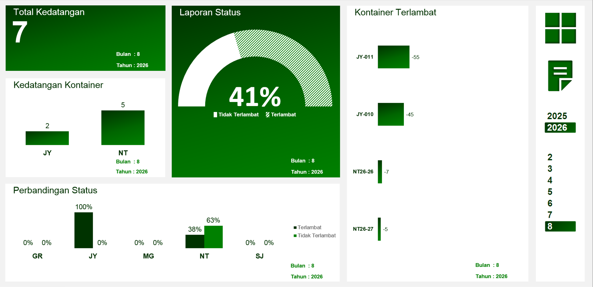

# Project 9: Dashboard *ETA Vs. ATA* Kontainer

Proyek pemantauan rantai pasok (*supply chain*) ini berfokus pada kepatuhan jadwal pengiriman dari pihak eksternal untuk memitigasi risiko kelangkaan bahan baku (*stockout*).

## Isu
Jadwal kedatangan bahan baku logistik sangat tidak stabil. Keterlambatan suplai mengganggu jadwal perencanaan produksi (PPIC) dan memicu masalah mesin menganggur (*idle*) di area pabrik.

## Analisis Mendalam
Pemantauan *Estimated Time of Arrival* (ETA) versus *Actual Time of Arrival* (ATA) pada 7 kontainer bulan Agustus 2026 mengungkap masalah keterlambatan. *Supplier* dengan kode JY memiliki rekam jejak terburuk dengan tingkat keterlambatan 100%. *Supplier* NT menyusul di urutan kedua dengan tingkat keterlambatan pesanan mencapai 63%. 

## Saran
1. **Penalti Tegas (*SLA Penalty*):** Jatuhkan denda keterlambatan kepada *Supplier* JY sesuai dengan kontrak penyediaan barang. Jika kinerja tidak membaik di kuartal berikutnya, pertimbangkan terminasi kontrak.
2. ***Multi-Sourcing Strategy*:** Tim Pengadaan harus segera mencari dan menyetujui minimal 2 *supplier* cadangan untuk kategori bahan baku yang dipasok oleh JY dan NT guna mendiversifikasi risiko gangguan pasokan.

## Catatan
Informasi mengenai performa keterlambatan kedatangan kontainer pada *raw material* sudah masuk di jajaran manajerial untuk dilakukan evaluasi. Karena akan mengganggu *supply chain* di *section production* dan tentunya perhitungan *Break Even Point (BEP)* serta *Return on Investment (ROI)* akan semakin bertambah waktunya khususnya jika kondisi mesin dalam status *idle*.
