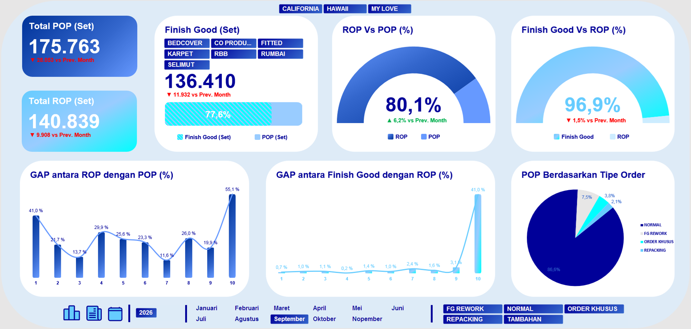

# Project 10: Dashboard *Tracker Sales Order, Production Order, Finish Good*

Proyek ini melacak tingkat keberhasilan (*conversion rate*) dari target awal rencana pesanan (*Sales/Production Order*) hingga menjadi barang siap jual (*Finish Good*).

## Isu
Manajemen membutuhkan kepastian apakah *Production Order* harian mampu dikonversi secara akurat oleh tim pabrik agar pesanan pelanggan (*Sales Order*) tidak *backlogged*.

## Analisis Data
Berdasarkan jenisnya, 86,6% pesanan merupakan tipe "Normal". Target *Production Order* pabrik ditetapkan pada 140.839 set, dan realisasi aktual *Sales Order* melampauinya hingga mencapai 175.763 set. Yang terpenting, penyelesaian akhir *Finish Good* berhasil dibukukan pada angka 136.410 set. Artinya, pabrik memiliki tingkat akurasi konversi barang jadi sebesar 96,9% dari total rencana semula.

## Saran
1. **Agresivitas Tim Penjualan:** Tingkat keberhasilan pemenuhan pesanan sebesar 96,9% membuktikan keandalan operasional. Divisi Penjualan (*Sales*) disarankan untuk lebih berani (agresif) dalam menerima kuota pemesanan (*Purchase Order*) tambahan dari distributor retail skala besar.
2. **Analisis Gap ROP vs POP:** Lakukan rapat sinkronisasi antar *section PPIC dan Produksi untuk mencari tahu mengapa eksekusi aktual (*Sales Order*) jauh lebih tinggi (175 ribu) dari rencana *Production Order* (140 ribu) untuk menghindari penumpukan persediaan (overstock) bahan baku.

## Catatan
Munculnya GAP yang cukup tinggi khususnya antara *Sales Order* dan *Production Order* karena kedatangan *raw material* dianggap tepat waktu sesuai kondisi *ETA* sehingga tim *Sales* beranggapan bahwa tim *Plant* khususnya *section* PPIC dan Produksi dapat memenuhi permintaan *Sales*. Namun kondisinya aktual performa kontainer yang membawa *raw material* tidak demikian. Selain itu juga saat ini sudah dilakukan perbaikan administrasi secara bertahap di ERP, karena pada periode tahun sebelumnya masih banyak ditemukan kode pada *Sales Order* tidak sinkron dengan *Production Order* sehingga ini juga akan menimbulkan GAP secara teknis administrasi.
