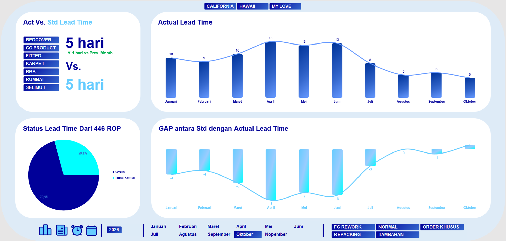

# Project 11: Dashboard *Lead Time* Produksi

Proyek ini mengevaluasi keandalan durasi pemrosesan barang, dari sejak bahan baku naik ke lini mesin potong hingga menjadi produk jadi, guna menilai ketepatan waktu pengiriman.

## Isu
Variansi waktu penyelesaian antar pesanan dapat merusak jadwal distribusi logistik dan mengecewakan pelanggan akhir dalam hal ini tim *Sales* yang dijanjikan waktu spesifik.

## Analisis Data
Data memvalidasi bahwa waktu penyelesaian operasional sangat terkendali. Rata-rata *Actual Lead Time* secara konsisten ditutup pada 5 hari kerja, sejajar tepat dengan *Standard Lead Time* yang diamanatkan perusahaan (5 hari). Dari analisis status penyelesaian atas total 446 *Production Order*, tingkat kepatuhan ketepatan waktu (*compliance*) mencapai titik solid sebesar 70,9%.

## Saran
1. **Jaminan *Customer Service*:** Jadikan angka *Lead Time* 5 hari kerja ini sebagai SLA baku yang dapat diiklankan (dijanjikan) kepada konsumen atau *buyer* tanpa risiko gagal janji (*over-promising*).
2. **Fokus pada 29% Keterlambatan:** Audit 29,1% ROP yang tidak sesuai target waktu. Identifikasi apakah keterlambatan tersebut disebabkan oleh tipe order spesifik seperti "Rework" atau "Order Khusus".
