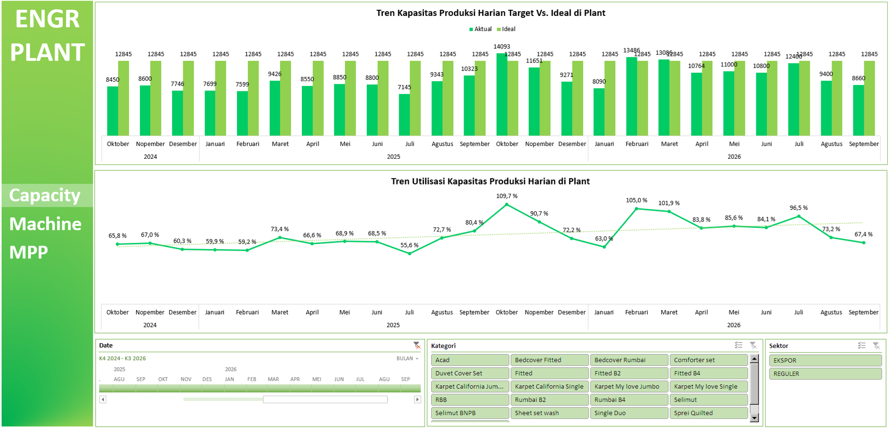
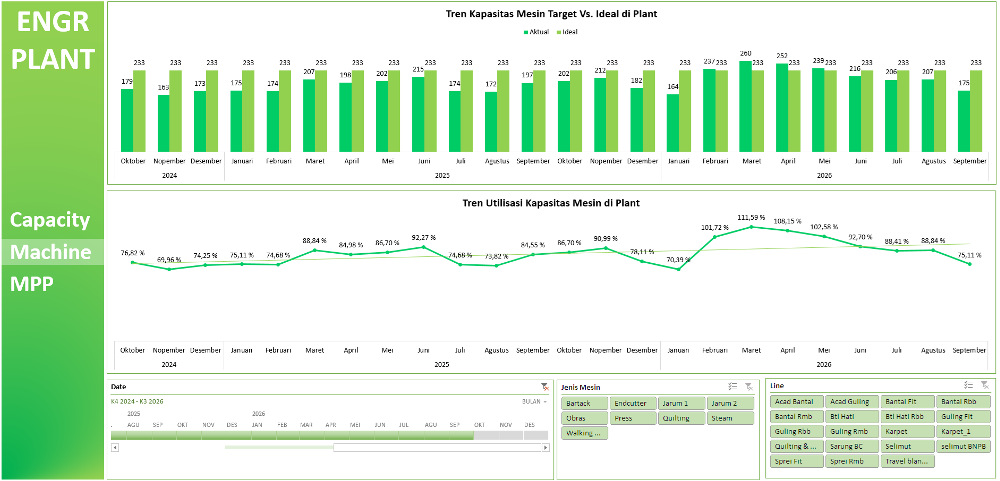
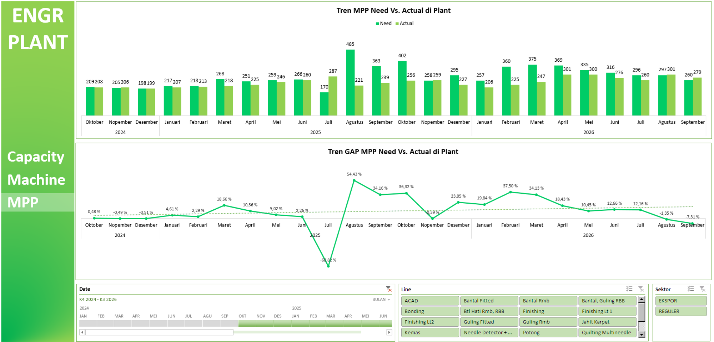

# Project 12: Dashboard *Engineering Plant*

Fokus proyek ini adalah menelaah kapasitas utilisasi mesin pabrik secara harian dan menganalisis kesenjangan (*gap*) ketersediaan tenaga kerja aktual (*Man Power Planning*) terhadap kuota yang ditetapkan berbasis kapasitas produksi.

## Isu
Terjadi indikasi penurunan produktivitas fasilitas secara bertahap pada kuartal berjalan yang menyebabkan aset mesin pabrik banyak yang *idle* (menganggur).

## Analisis Data
Tren data membuktikan bahwa persentase utilisasi kapasitas mesin mengalami pelemahan, merosot dari 73,2% di bulan Agustus 2026 menjadi 67,4% di bulan September 2026. Pelemahan kapasitas ini memiliki korelasi kausal secara langsung dengan minimnya pekerja di lapangan. Analisis *Man Power Planning* (MPP) memvalidasi adanya defisit kehadiran tenaga kerja (*GAP MPP Need vs Actual*) di angka -7,31% pada bulan September.

## Saran
1. **Akselerasi *Rekrutmen Direct Labor*:** Penurunan utilisasi disebabkan oleh kurangnya jumlah "tangan" operasional. Departemen HR&GA harus mempercepat *onboarding* Operator untuk menutup *gap* -7,31% tersebut.
2. **Alokasi Shift Lembur:** Selagi menunggu tenaga kerja baru, berikan alokasi jam lembur pada hari kerja untuk mengembalikan kapasitas utilisasi mesin kembali ke atas 73%.
