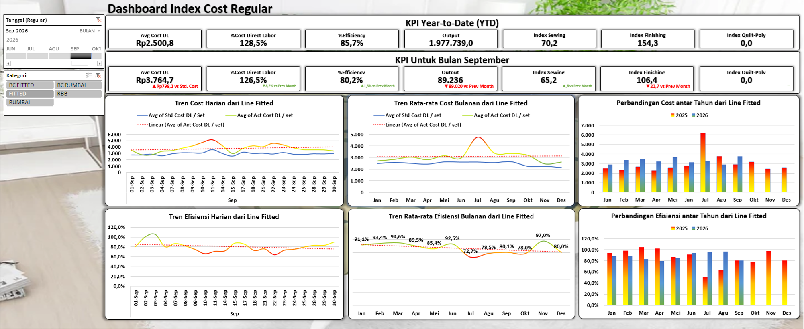
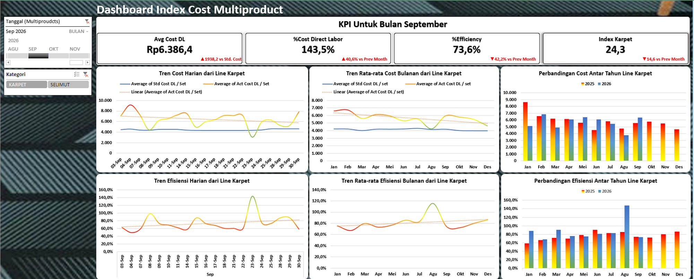

# Project 13: Dashboard *Cost dan Index Product*

Dashboard ini mengurai rasio efisiensi dan Biaya Tenaga Kerja Langsung (*Cost DL / Direct Labor*) per unit untuk menemukan lini mana yang memakan biaya berlebih (*over budget*).

## Isu
Manajemen membutuhkan transparansi untuk mengetahui lini produk mana yang menggerus profit (margin kotor rendah) akibat tingginya waktu pemrosesan dan biaya buruh per potong barang.

## Analisis Data
Lini "Fitted" terbukti beroperasi sangat efisien (85,7%) dengan pengeluaran *Avg Cost DL* paling murah yakni Rp2.500,8/set. Sebaliknya, lini "Multiproduct Karpet" menjadi yang paling inefisien; efisiensinya terpuruk di 73,6% dengan *Cost DL* bengkak hingga Rp6.386,4/set.

## Saran
1. **Intervensi *IE*:** Langkah aksi dari tim *Industrial Engineering* (IE) untuk melakukan observasi *Time & Motion Study* di line Karpet.
2. **Redesain Proses (Alat Bantu):** Rancang alat bantu pelipatan/penjahitan (*jig*) atau perbaiki susunan area kerja pada lini tersebut agar durasi pengerjaan (*Standard Minute Value*) menyusut dan efisiensi meningkat melewati batas wajar 80%.
