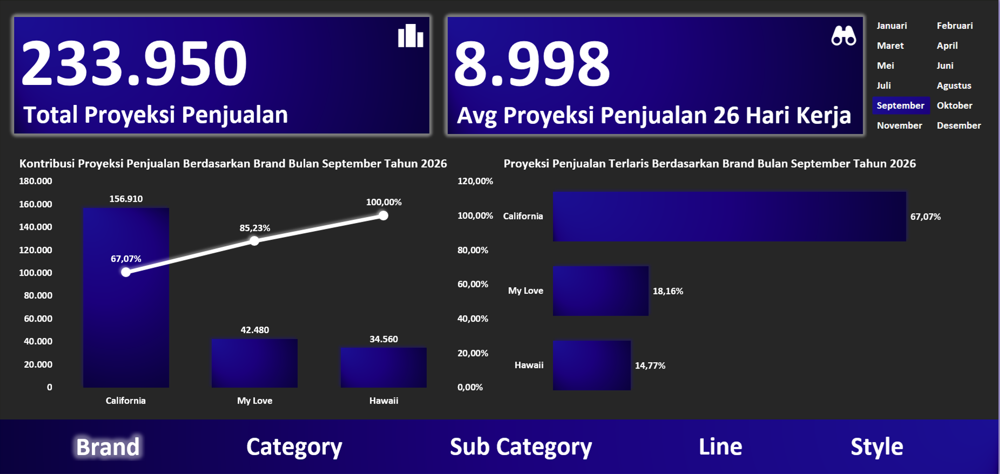
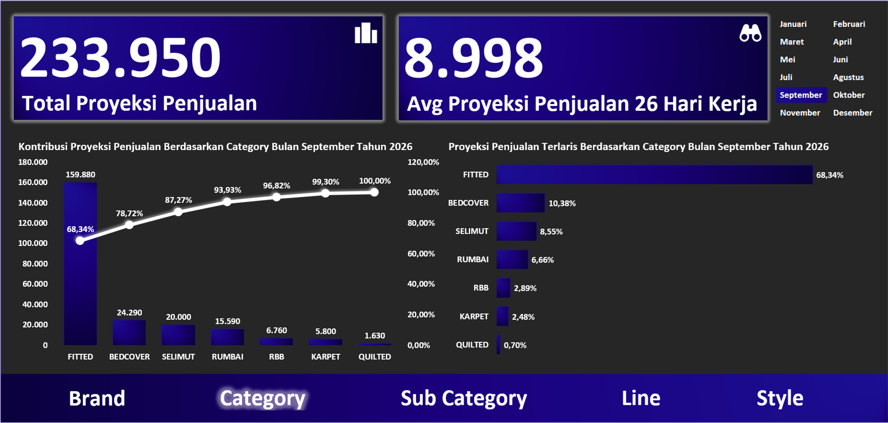
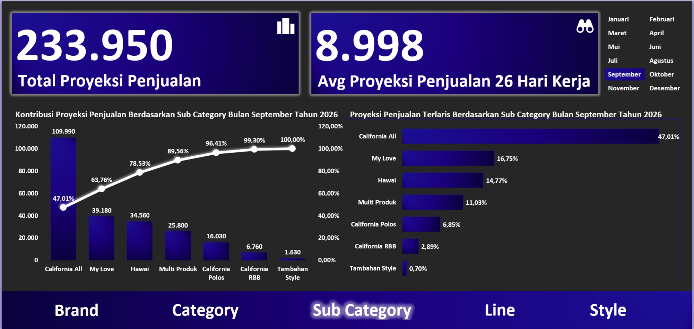
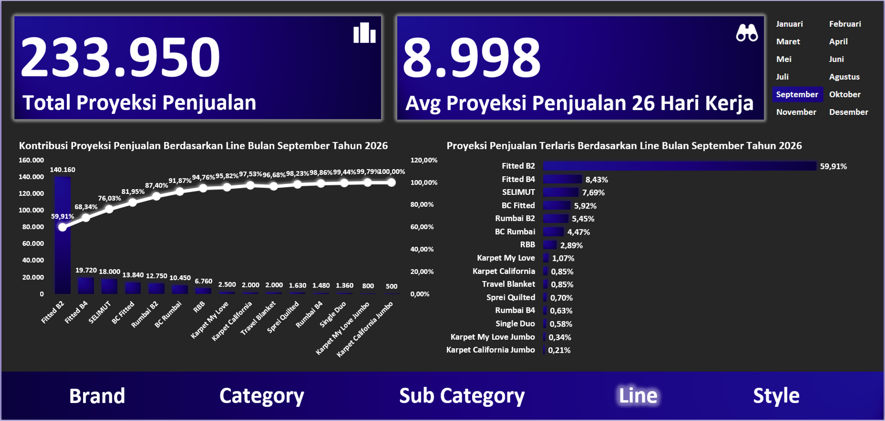
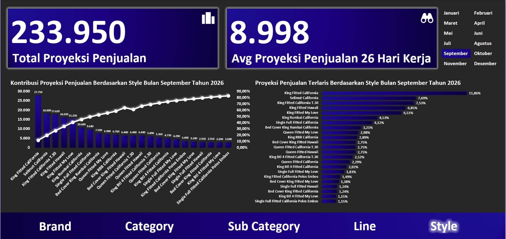

# Project 14: Dashboard Proyeksi Penjualan

Analisis tren pasar untuk memetakan dominasi merek (*brand*) dan varian produk. Proyeksi ini sangat vital bagi PPIC untuk menetapkan prioritas pemesanan bahan baku bulan berikutnya.

## Isu
Pabrik perlu mengidentifikasi lini produksi mana yang menjadi tulang punggung penghasilan perusahaan (*cash cow*) guna mengamankan arus kas (*revenue*).

## Analisis Data
Data memproyeksikan total volume penjualan sebesar 233.950 unit, setara dengan rata-rata ritme penjualan 8.998 unit per hari kerja. Ekosistem penjualan dikuasai secara dominan oleh *Brand* California yang menyumbang 67,07% pasar (156.910 unit). 
Secara bentuk produk, model *Fitted* menjadi jawara kategori dengan porsi 68,34% (159.880 unit), yang secara spesifik dirajai oleh varian *Fitted B2* (59,91% / 140.160 unit). Angka ini membuktikan adanya risiko ketergantungan pendapatan yang tinggi pada satu varian semata.

## Saran
1. **Prioritas Alokasi Anggaran *Raw Material*:** PPIC harus mengunci (*lock*) prioritas anggaran pembelian material mentah (*RM*) guna menjamin tidak adanya kehabisan stok untuk lini *Fitted B2 California* selama 3 bulan ke depan.
2. **Perawatan Mesin Prioritas:** Berikan prioritas layanan mekanik (*fast-lane maintenance*) pada mesin-mesin penjahit lini *Fitted B2* agar kapasitas produksinya tidak terganggu sedikit pun.

## Catatan
Informasi proyeksi penjualan sudah menjadi acuan untuk *balancing* di *section Production* namun hal ini tentu perlu pengawasan lebih lanjut karena tentu akan berdampak pada *SLA Lead Time* Produksi tentunya apabila terdapat skala prioritas yang mengacu pada informasi *Paretto Chart* Proyeksi Penjualan.
