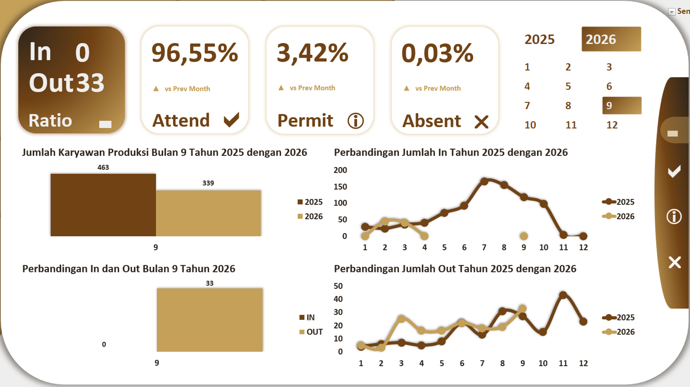
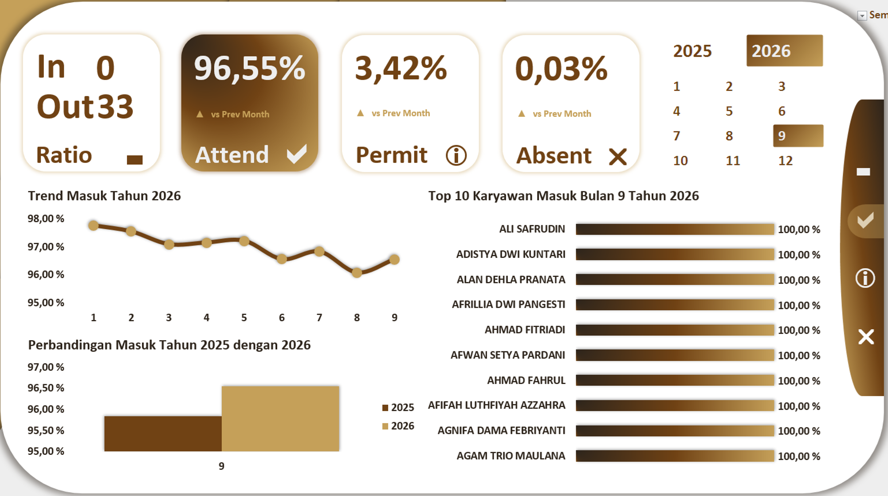
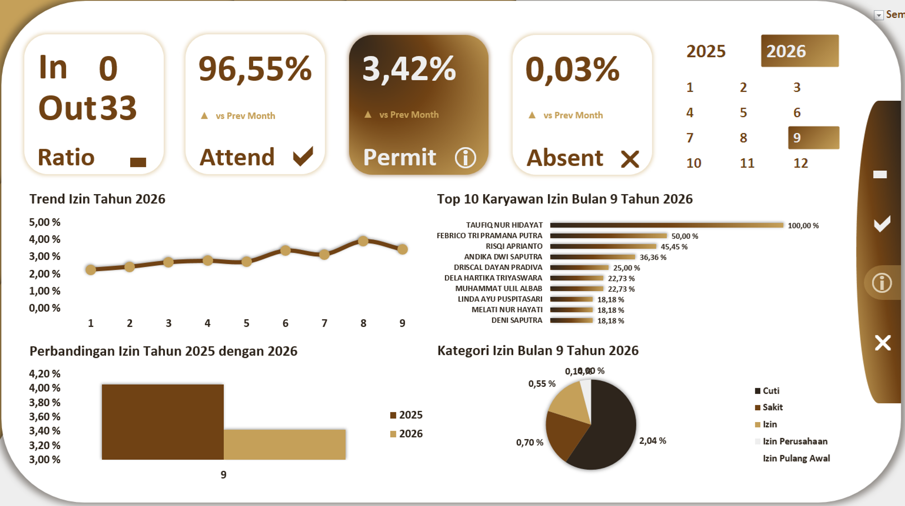
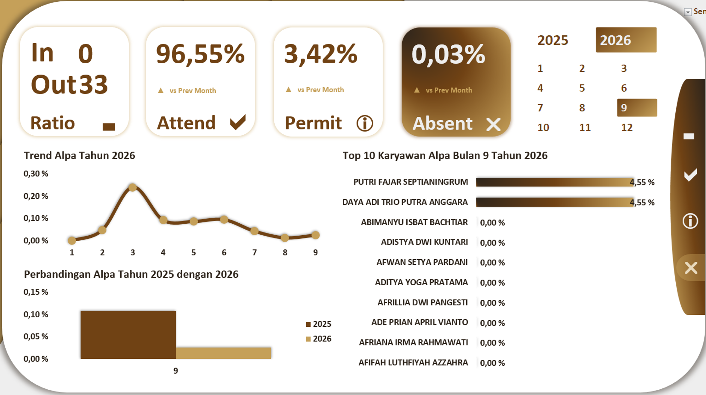

# Project 15: Dashboard Absensi Produksi

Pemantauan rasio kedisiplinan dan tingkat kehadiran (*Attend, Permit, Absent*) dari karyawan di *section Production*.

## Isu
Tingkat absensi yang buruk, terutama tanpa keterangan (mangkir/alpa), adalah penyebab utama kegagalan target harian (*output*) karena mesin ditinggalkan kosong oleh operator yang dijadwalkan.

## Analisis Data
Data membuktikan kepatuhan disiplin dan moral karyawan sangat kuat. Di *section Production*, metrik menunjukkan angka yang positif dengan kehadiran (*Attend*) 96,55%, izin 3,42%, dan alpa hanya di level sangat minim 0,03%.

## Saran
1. **Pertahankan Kebijakan Kompensasi:** Karena masalah absen tanpa keterangan nyaris tidak ada (0%), perusahaan disarankan mempertahankan program tunjangan kehadiran yang sedang berjalan.
2. ***Cross-Training Operator*:** Manfaatkan kehadiran yang stabil ini untuk melakukan *cross-training* silang, agar saat 3% pekerja mengambil izin sakit/cuti, operator cadangan di *line* lain dapat langsung mengisi kekosongan mesin secara dinamis.
