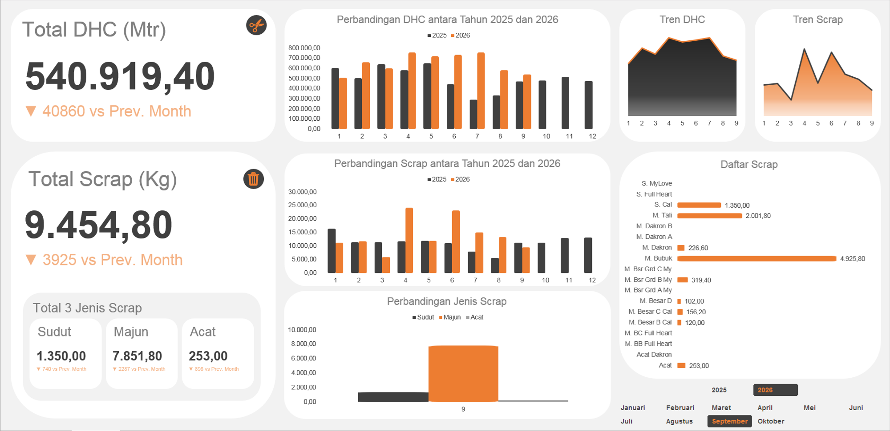

# Project 16: Dashboard Hasil *Cutting Vs. Scrap*

Proyek analisis limbah (*Scrap*) ini mengukur seberapa efisien proses pemotongan mesin dengan menghitung selisih meteran kain yang diproses dengan berat kilo kain yang terbuang.

## Isu
Meskipun hasil produksi terlihat normal, laporan keuangan material mentah membengkak akibat tingginya *waste* (pemborosan) fisik pada tahap paling awal operasional pabrik.

## Analisis Data
Statistik mencatat total pergerakan potongan kain (*Direct Head Count* / DHC) sebesar 540.919,40 Meter. Dari proses ini, pabrik menghasilkan akumulasi limbah (*Scrap*) hingga 9.454,80 Kg. 
Analisis kategori membedah bahwa penyumbang inefisiensi raksasa adalah potongan sisa jenis "Majun" yang menelan porsi buangan sebesar 7.851,80 Kg. Angka buangan majun seberat nyaris 7,8 ton ini menjadi bukti teknis bahwa susunan (peta pola) yang dicetak di atas kain masih sangat renggang.

## Saran
1. **Pembaruan Algoritma Auto-Nesting:** Lakukan pembaruan (*upgrade*) atau konfigurasi ulang pada perangkat lunak (*software*) penyusun pola otomatis mesin *plotter* agar komputasi kepadatan titik potong lebih rapat.
2. **Evaluasi Desain *Marker*:** Departemen Strategi perlu merevisi bentuk potongan desain (khususnya sudut) agar sisa kain (*waste*) dapat diminimalisir.
