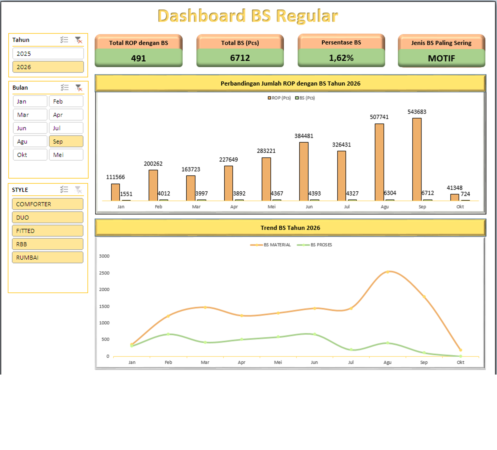
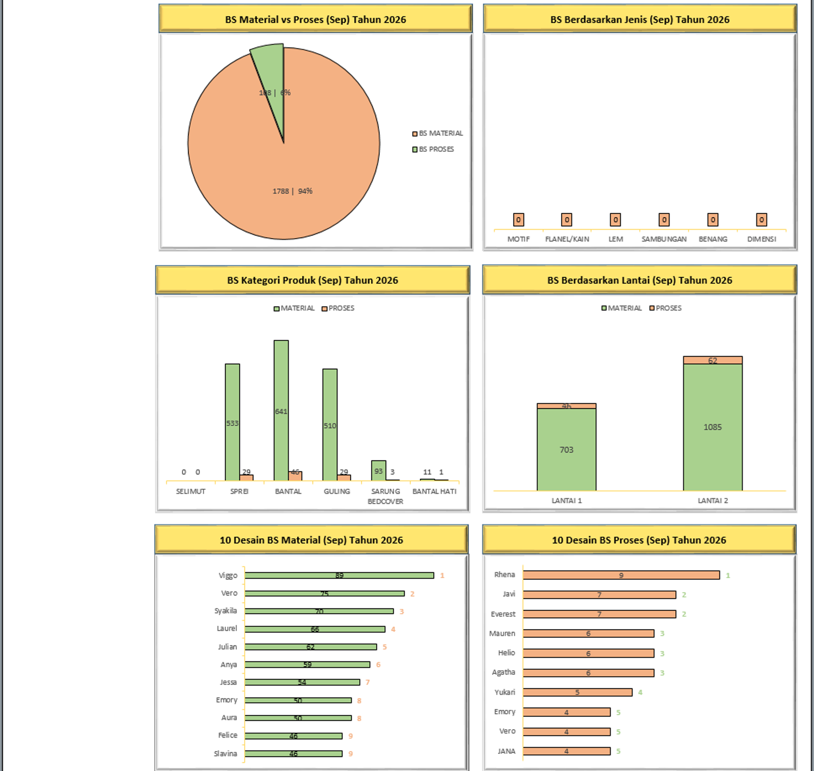
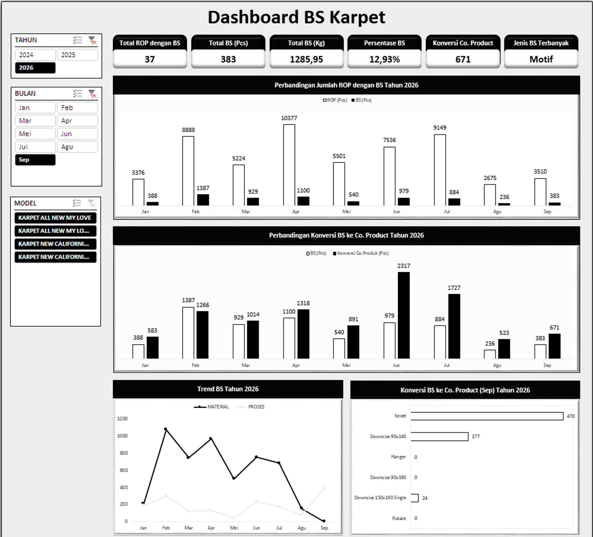
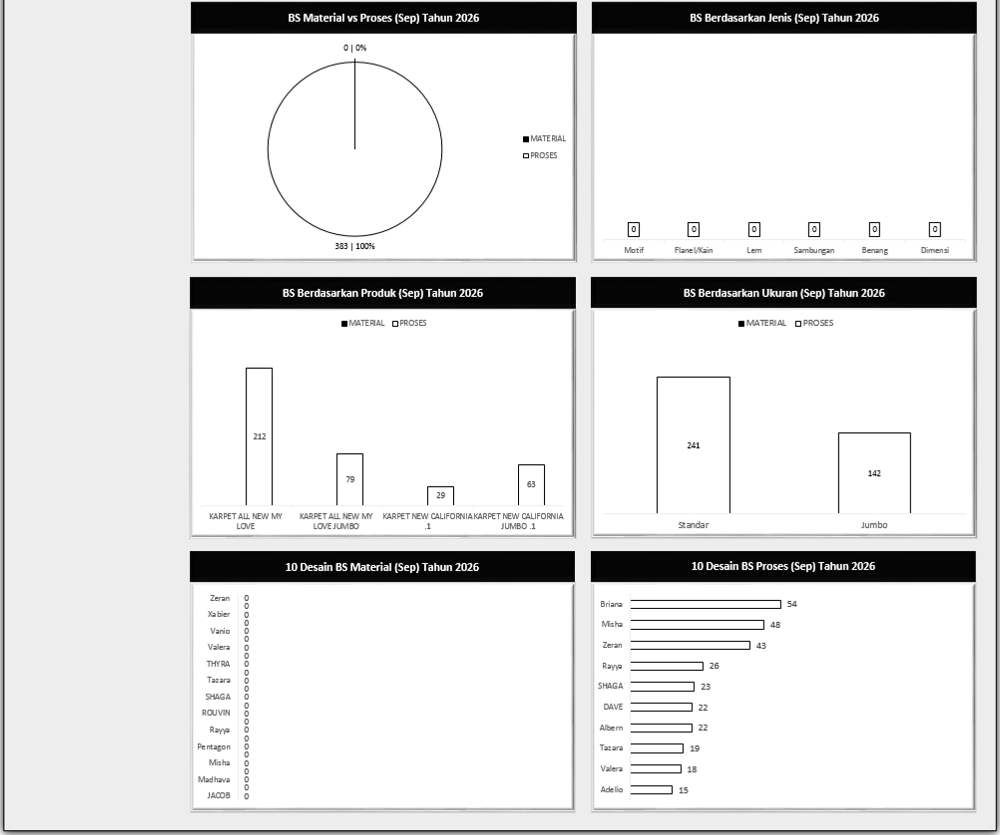
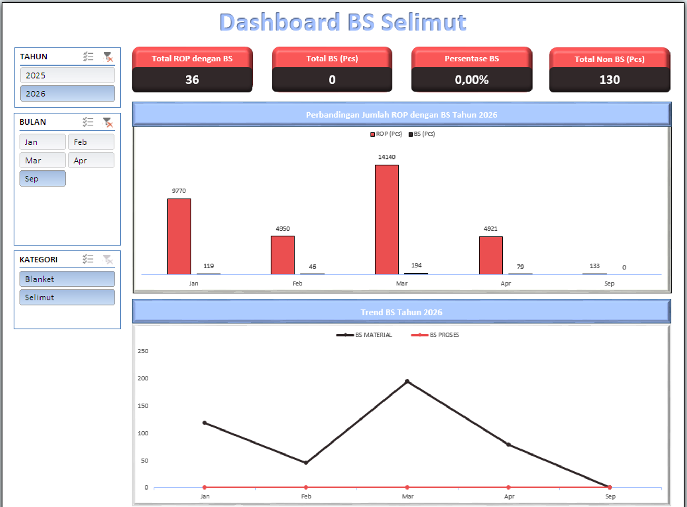
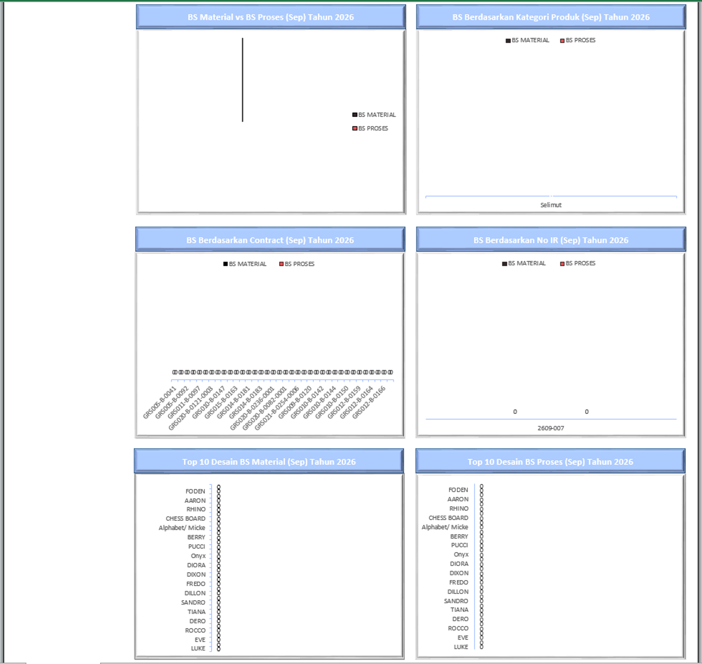

# Project 18: Dashboard Defect Product

Proyek ini memantau persentase penolakan kualitas akhir (Barang Sortir/BS) yang tidak lolos standar mutu pabrik, serta rasio keberhasilan *rework* menjadi produk *co-product*.

## Isu
Barang Sortir (BS) adalah kerugian material murni karena bahan, waktu, dan listrik telah terpakai namun barang gagal dijual pada harga penuh.

## Analisis Data
Performa lini produk Reguler sangat mengesankan, di mana persentase BS mampu ditekan hingga 1,62% (6.712 Pcs) dengan mayoritas tolakan terjadi pada alasan "MOTIF". 
Sebaliknya, departemen menemukan anomali pada lini Karpet; angka Barang Sisa (BS) melesat hingga 12,93%. Sebagai langkah mitigasi kerugian, pabrik berhasil melakukan proses *rework* pada 671 unit karpet cacat tersebut dan mengonversinya menjadi *Co. Product* (produk afkir layak pakai).

## Saran
1. **SOP Inspeksi *Incoming Material*:** Cacat akibat "MOTIF" (khususnya di Karpet) menunjukkan material dari *supplier* lolos ke meja jahit. Wajibkan tim QC Gudang membentangkan gulungan material secara acak dan memverifikasi kualitas motif sebelum dimasukkan ke antrean produksi harian.

## Catatan
Tingginya angka BS di produk karpet yang termuat pada data ini, maka manajemen melakukan aksi pembatasan produksi di produk karpet yang fokusnya lebih berbasis permintaan. Karena beberapa langkah sudah dilakukan seperti penyeragaman ukuran material di waktu proses bonding, pergantian model lem cair sampai lembaran tapi angka BS masih tinggi di dua digit persen. Indikasi besar ditemukan oleh tim IE bahwa pada mesin yang tidak sesuai dengan standar panas sehingga lem tidak merekat sempurna waktu di proses bonding.
