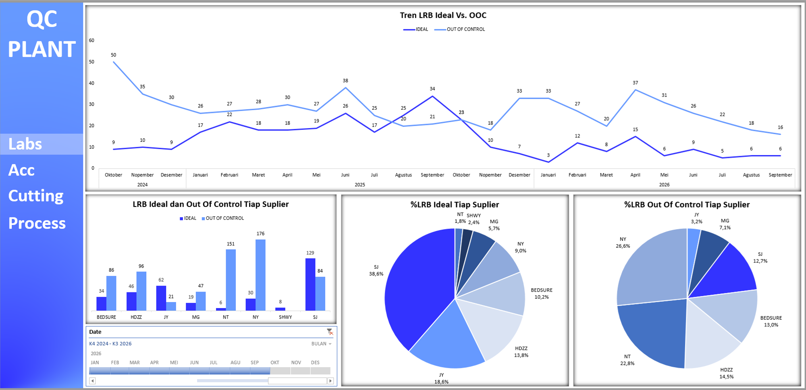
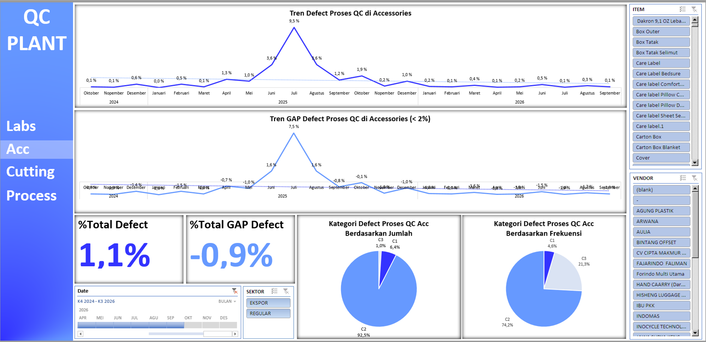
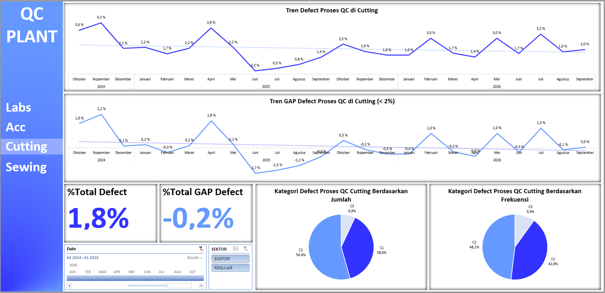
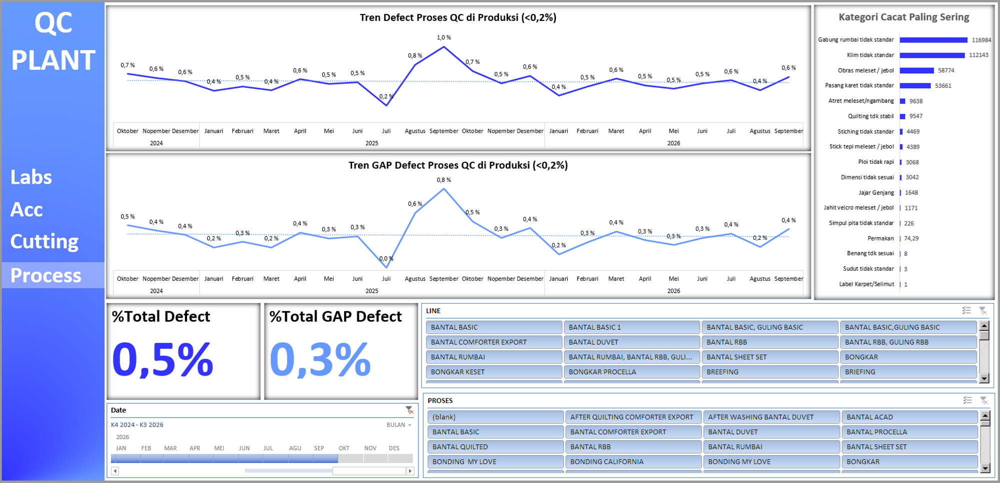

# Project 19: Dashboard QC Plant

Proyek Quality Control komprehensif ini menelusuri tingkat kecacatan (*defect rate*) harian dari awal inspeksi material pemasok hingga pemeriksaan hasil jahitan lini akhir.

## Isu
Manajemen harus memisahkan apakah buruknya kualitas produk akhir bersumber dari keterampilan menjahit operator yang buruk atau dari bahan material pabrikan (*supplier*) yang memang sudah rusak.

## Analisis Data
Pada tahap awal material masuk, *Supplier* NY mencatat kualitas terburuk dengan 26,6% bahan masuk kategori *Out of Control (OOC)*, disusul oleh NT (22,8%). 
Di area internal penjahitan (Produksi), tim berhasil menjaga tingkat cacat keseluruhan (*Total Defect*) di level minim 0,5%. Walau persentase kecil, analisis frekuensi kecacatan (*Pareto*) mengidentifikasi dua pemicu masalah absolut: "Gabung rumbai tidak standar" (116.984 temuan kasus) dan "Klim tidak standar" (112.143 temuan kasus).

## Saran
1. **Negosiasi Supplier:** Karantina, retur, atau hentikan pengadaan bahan sementara dari *Supplier* NY karena 1/4 pasokannya gagal lolos batas kendali (*OOC*).
2. **Kalibrasi & *Training* Spesifik:** Kesalahan rumbai dan klim menandakan operator gagal menjaga konsistensi lipatan jahitan. *Supervisor Sewing* harus melakukan *training* harian kilat dan kolaborasi dengan tim Mekanik untuk rutin mengecek pengaturan sepatu jahit di seluruh lini mesin obras/klim.
