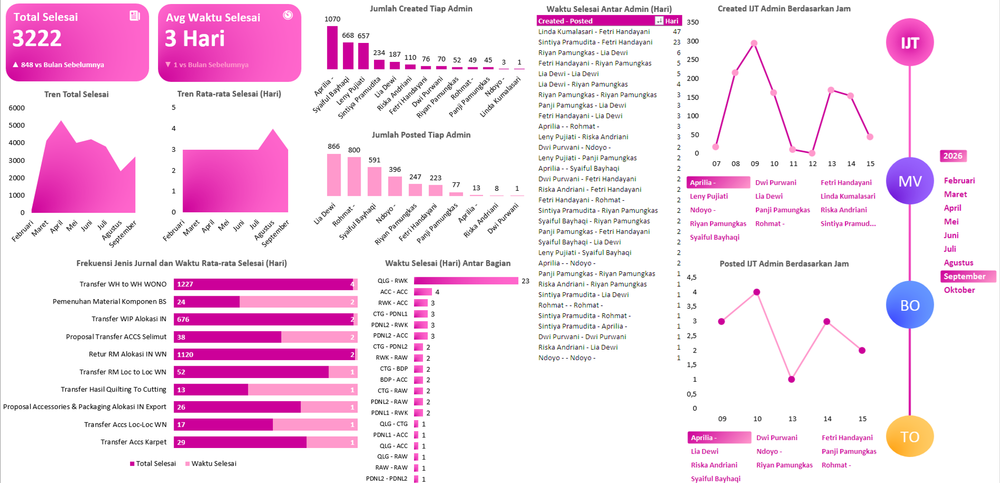
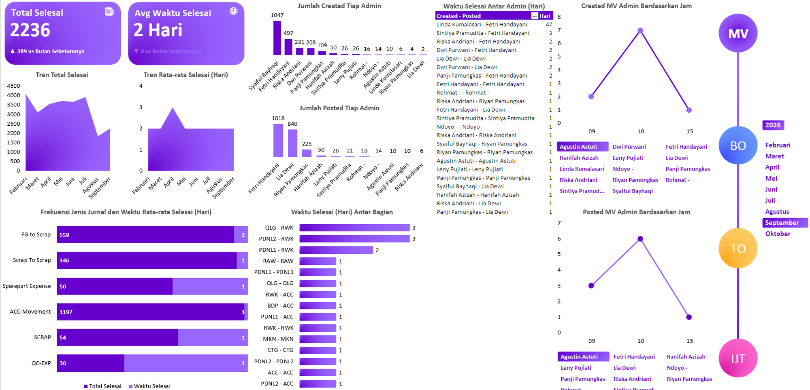
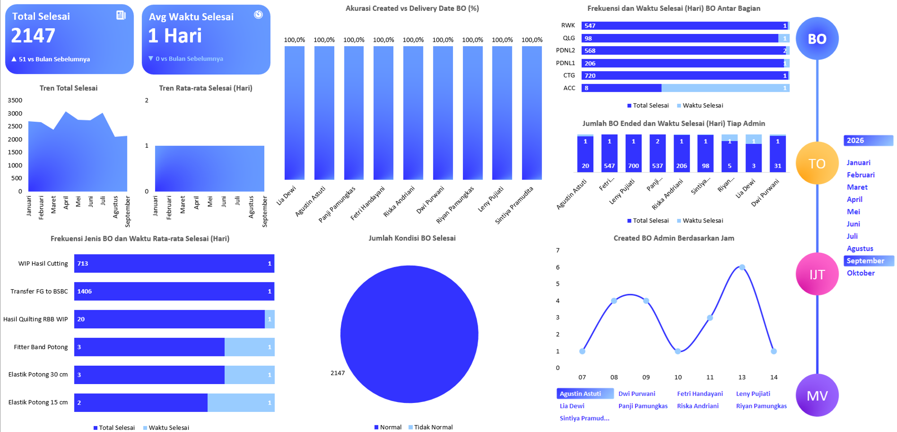
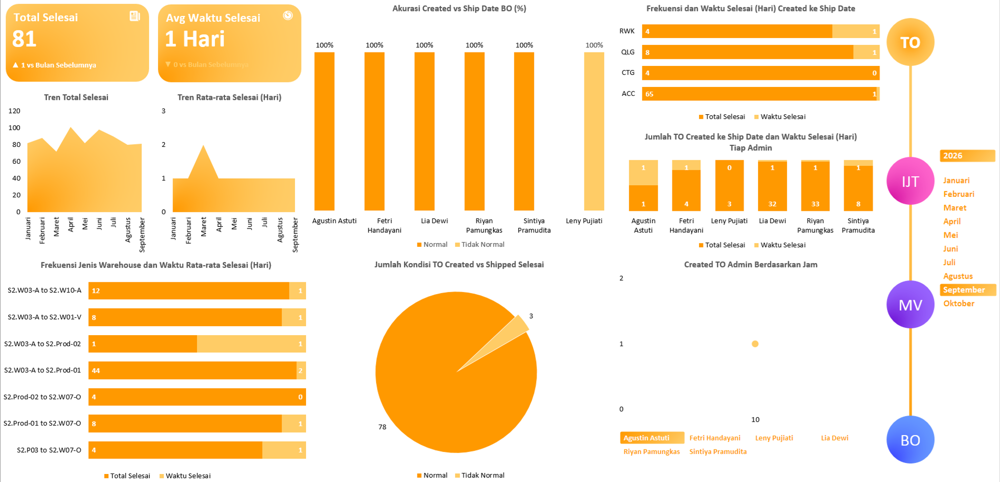

# Project 20: Dashboard Performa Admin

Proyek ini memonitor beban kerja dan kecepatan eksekusi tim admin dalam mem-*posting* dokumen sistem ERP (Microsoft Dynamics AX). Keterlambatan input data menyebabkan visibilitas ketersediaan barang di *on-hand inventory* bermasalah.

## Isu
Meskipun arus pergerakan barang fisik di lapangan lancar, sistem sering menunjukkan *on-hand* antara di sistem dan fisik berbeda karena lambatnya penginputan data perpindahan inventaris secara digital.

## Analisis Data
Kinerja pembuatan dokumen distribusi logistik seperti *Bacth Order* (BO) dan *Transfer Order* (TO) sangat cepat, di mana rata-rata pencatatan selesai ditutup dalam 1 Hari kerja.
Namun, terjadi kemacetan (*bottleneck*) administratif parah di *Inventory Jurnal Transfer (IJT)* (dengan total beban 3.222 tugas). Rata-rata waktu penyelesaian dokumen di sektor ini memakan waktu lambat hingga 3 Hari. Kepadatan tertinggi bersumber dari dokumen jenis *Transfer WH to WH WONO* yang mencapai 1.227 *posting* tertunda.

## Saran
1. **Otomatisasi ERP Mobile (Barcode):** Selama admin di Plant masih menggunakan input manual (kertas ke komputer), jeda 3 hari *inventory lag* ini akan terus terjadi. Perusahaan harus berinvestasi pada *PDA Barcode Scanner* di semua *section* tidak hanya di *section warehouse* saja. Ketika material dipindahkan dari rak, *scanner* akan seketika mengeksekusi perpindahan secara *real-time* ke sistem AX, menghapus kemacetan 72 jam menjadi 0.
