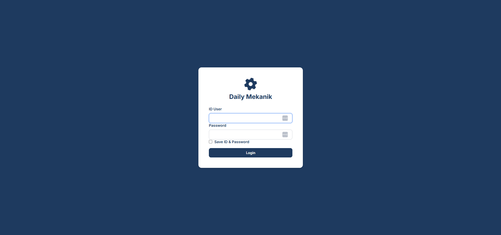
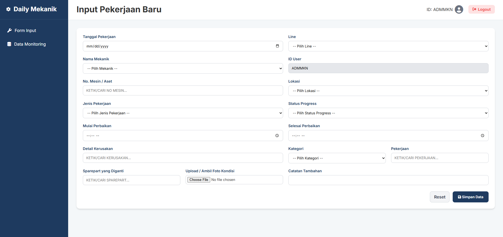
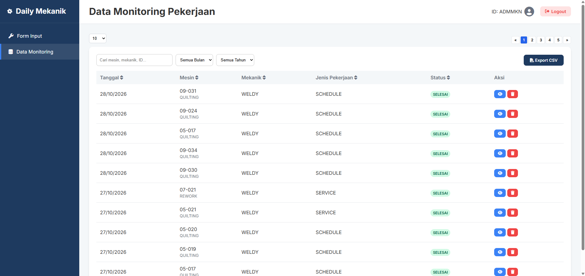
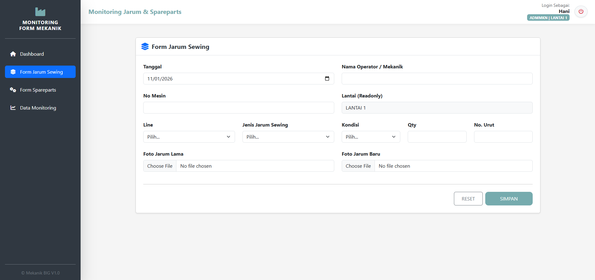
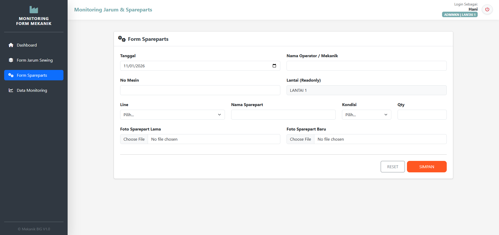
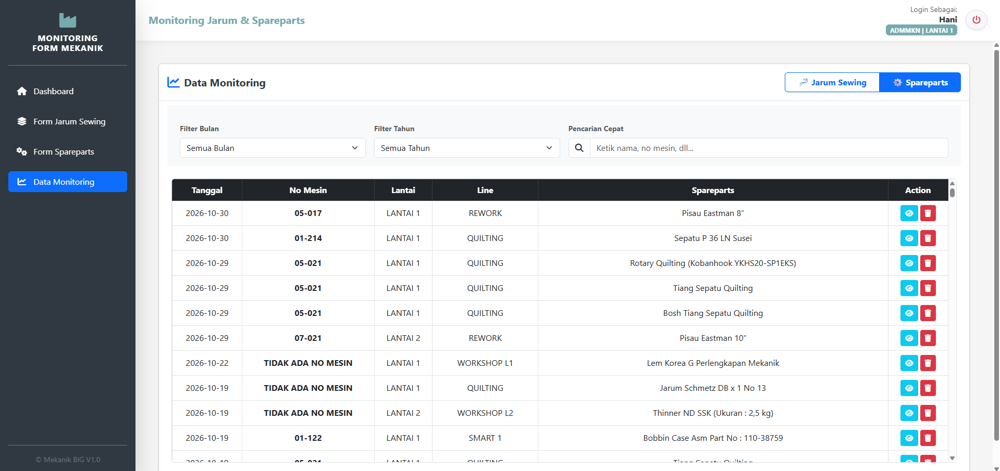

# Project 21: Otomatisasi Data Plant
Proyek ini melakukan percepatan arus data secara *real-time* untuk inputan data di area pabrik yang belum terintegrasi dengan sistem ERP.

## Isu
Sistem ERP yang sudah tersedia secara langsung sudah membantu operasional administrasi di pabrik, namun untuk operasional yang tidak terhubung ke ERP masih belum terakomodir karena beberapa alasan. Kemudian juga penggunaan kertas di setiap pencatatan juga masih dilakukan di semua section *Plant*.

## Catatan
Untuk proyek ini sementara masih dilakukan di section *Engineering* karena data tidak bersifat sensitif. Karena inputan data ini berbasis penyimpanan *cloud server* dikhawatirkan apabila data yang sensitif nanti bisa terjadi kebocoran data. Serta inputan data yang datanya bersifat sensitif, saat ini sudah dilakukan *trial* menggunakan *local server* dengan fitur VBA di Microsoft Excel.
